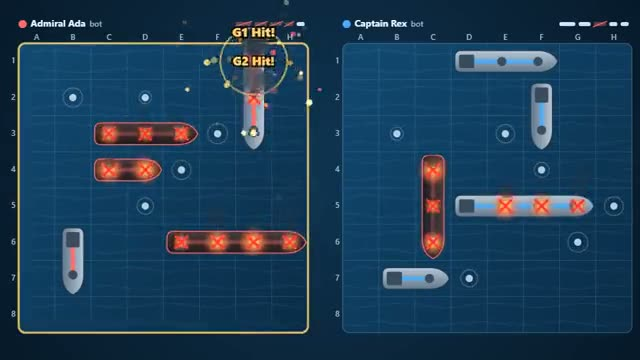

# Fleet Battle

Hide your fleet. Find theirs. A hit fires again. A multiplayer starter game from [Multiplayer Agent](https://multiplayeragent.com): 2D, turn-based, 2 players, with a bot that takes the empty seat.

## How it plays

Drag your five ships into place, then take turns firing at the enemy grid. A hit lets you fire again; sink every enemy ship first to win.

**Controls:** Drag ships to move, tap to turn; click or tap a square to fire (arrows + Space work too).

## Make it yours in the Game Builder

Open the [Game Builder](https://multiplayeragent.com), choose **Start from a starter game** and pick Fleet Battle. It opens as version 1 in your studio, ready to play and publish. Then ask for changes, for example:

- Make the grid 10 by 10 with a sixth ship
- Add a radar that reveals a 3 by 3 area once per match
- Make it space, with spaceships and asteroids

## Run it yourself

1. Get a free publishable key (`pk_…`) at [multiplayeragent.com](https://multiplayeragent.com).
2. In `index.html`, put it in place of `pk_REPLACE_ME` in the `MP_CONNECT` block.
3. Open `index.html` in a browser. No build step and no server needed.

Without a key it still runs, offline against a bot.

## How it is built

- One `index.html`. The comment at the top of the script maps the code and explains the multiplayer.
- **Hidden info:** Your ships are sealed so only you can read them (the host answers every shot, so it can too).
- **Host-run rules:** The host's browser checks every shot and runs the turns; if it leaves, the next player takes over.
- **Bots:** A bot captain takes the empty seat, and a friend who joins takes over its fleet.
- **Leaderboard:** Matches won, shown after every match.
- `?attract` runs it offline with bots only. The preview video is recorded from it.

## License

MIT.
